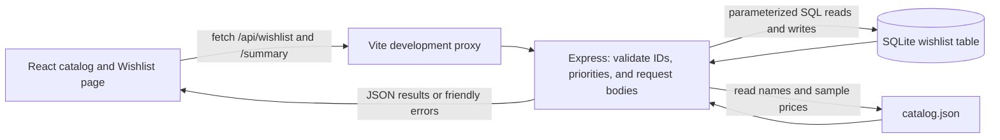

# PLAYER ONE — Saved Game Wishlist

Lesson 12 planning draft · October 22, 2026 · Prepared with AI assistance.

**Approval status: awaiting instructor review. No capstone implementation is claimed complete.**

## Direction and starting point

Full Stack capstone direction C: add a new feature to my own existing codebase. The base is [PLAYER ONE](https://github.com/JustJiminAround/video-game-store), a React/Vite game storefront with an Express practice API. Its cart currently resets on refresh. The capstone adds a separate saved wishlist; the cart remains a sample shopping cart.

Record the feature as a GitHub issue before implementation, reference the issue from a feature branch and pull request, and merge the verified pull request before Demo Day. The feature includes a table and an endpoint designed for this capstone.

## Problem

Visitors can browse PLAYER ONE, but they cannot keep a list of games they want to play later. A small saved wishlist lets them return to those games after refreshing the page or restarting the app server.

## Users

A student trying the private classroom demo. This is one shared demonstration wishlist, with no accounts or personal information.

## Inputs and outputs

Inputs: an existing catalog game ID, Add/Remove actions, and a priority of `normal` or `high`.

Outputs: a Wishlist page showing saved games and their priorities, a friendly empty state, and a summary showing the saved-game count, high-priority count, and total sample price. All saved-list reads and writes go through Express to SQLite. Prices remain sample prices, and no purchases occur.

Core loop: **browse → save a game → view the wishlist → refresh → see it again**.

## Numbered acceptance criteria

These are planned checks for L13–L15; they are not checked off today.

1. Adding Minecraft from the catalog sends a request to Express and creates a real SQLite wishlist row. The Wishlist page shows it, and adding it again produces a helpful already-saved message with only one row.
2. A saved game and its priority remain after a full browser refresh and an API-server restart. Verify this by selecting the SQLite row directly as well as reopening the page.
3. Changing a game's priority between normal and high updates SQLite and remains after refresh. Invalid priorities return JSON 400, unknown game IDs return JSON 404, and rejected requests do not change the stored rows.
4. Removing a game deletes its row and remains removed after refresh. Removing the last game displays a useful empty-wishlist message.
5. The custom `GET /api/wishlist/summary` endpoint calculates its result from the current saved rows. Minecraft plus Hades returns count 2 and totalSamplePriceCents 5498; marking Hades high returns highPriorityCount 1. Removing Minecraft changes the count to 1 and total to 2499.
6. The UI shows loading and friendly error states. An unsuccessful write does not display a success message. A failed request leaves the page usable, and wishlist controls have clear keyboard-accessible labels.
7. The repository includes the API contract, SQLite schema, architecture diagram, install/initialize/run instructions, and `.env.example`. Database files, secrets, and node_modules stay out of Git. A clean checkout can be started using the README.
8. API tests cover duplicate saves, validation, priority changes, deletion, persistence using a temporary database file, and summary totals. Existing cart/API checks, client lint, and production build pass; the live core loop is also checked in the browser.
9. The feature issue links to the pull request and verified result. AI_LOG.md records each work session, and a 4–6 minute live demo explains the feature, one real AI mistake, the verification evidence, and the remaining limits.

## Planned data model

One new SQLite table, `wishlist`:

| Column | Constraint and purpose |
| --- | --- |
| game_id | TEXT PRIMARY KEY; one saved row per existing catalog game |
| priority | TEXT NOT NULL DEFAULT 'normal'; CHECK IN ('normal', 'high') |
| created_at | TEXT NOT NULL DEFAULT CURRENT_TIMESTAMP; stable creation order |

The server validates game IDs against the existing catalog. The catalog remains the source of game names, artwork, and sample prices. SQLite stores the wishlist choices. The summary reads the saved rows and matches their IDs to the catalog, summing prices as integer cents. This avoids introducing a catalog editor or duplicating game details in the saved table.

Use parameterized SQL. Set the database file path with a server environment variable, and initialize the table reproducibly. Keep the API behind the existing Vite `/api` proxy and keep Codespaces ports private.

## Planned API contract

| Method and path | Input | Success | Expected failures |
| --- | --- | --- | --- |
| GET /api/wishlist | none | 200 `{ items: [{ gameId, name, priority, priceCents, image, createdAt }] }` | JSON 500 with a safe message for database failure |
| POST /api/wishlist | JSON `{ gameId }` | 201 `{ item }` with normal priority | 400 malformed body; 404 unknown catalog ID; 409 already saved |
| PATCH /api/wishlist/:gameId | JSON `{ priority: "normal" or "high" }` | 200 `{ item }` | 400 invalid body; 404 no saved row |
| DELETE /api/wishlist/:gameId | none | 204 with no body | 404 no saved row |
| GET /api/wishlist/summary | none | 200 `{ count, highPriorityCount, totalSamplePriceCents }` | JSON 500 with a safe message for database failure |

Return errors consistently as `{ error: "helpful message" }`. The summary endpoint is the custom operation beyond basic list/read: it combines saved choices with catalog data and calculates counts and a sample-price total on the server. It is not an echo route or a hard-coded answer.

## Planned architecture

Explanation: React displays the list and sends actions to Express. Express checks the request, reads or changes the SQLite file, combines saved game IDs with catalog details, and returns JSON. SQLite keeps the choices when React reloads. The Vite proxy allows the browser to use one authenticated Codespaces origin.

## Required-element mapping

| Requirement | Planned evidence |
| --- | --- |
| Real SQLite database and a designed table | wishlist schema, initialization, and direct SELECT checks |
| Custom endpoint beyond basic list/read | wishlist summary counts and sample-price calculation |
| Front end reads/writes through the API; refresh persistence | save, change priority, refresh, restart, and reopen |
| Explainable architecture diagram | planned diagram above; review and explain it before the demo |
| Complete AI-usage log | AI_LOG.md: asked, produced, fixed/rejected, verified each session |
| Working live demo | two games saved, high priority, refresh, summary, remove, empty state |
| Numbered acceptance criteria | checks 1–9 above, verified individually at freeze |
| Direction C delivery | issue → feature branch → reviewed/tested PR → merge |

## Milestone plan

| Lesson | What done looks like |
| --- | --- |
| L12 — Scope | Review this spec with the student and instructor, confirm or cut scope, record actual approval, and file the feature issue. Plan only; no application code today. |
| L13 — Foundations | Create the feature branch, SQLite initialization and table, implement and test list/save routes, and prove a real row survives reopening the database. |
| L14 — Core functionality | Connect React to the API; complete priority updates, deletion, custom summary, loading/error/empty states; prove the entire core loop survives refresh and server restart. |
| L15 — Freeze and verify | Stop adding features. Run checks 1–9, review every failure, simplify or remove optional work with instructor agreement, finish README/diagram/log, and merge the verified feature PR. Required pathway elements remain required. |
| L16 — Polish and rehearse | Fix remaining presentation rough edges, prepare made-up demo data, and rehearse the 4–6 minute talk. |
| L17 — Demo Day | Run the app live and explain the design, hardest problem, real AI mistake and correction, acceptance evidence, and next steps. |

## Out of scope

Accounts/login, separate wishlists per person, checkout/payments, real purchase prices, a catalog editor, game recommendations, social features, external game-data integrations, price alerts, public deployment, and a visual redesign. The existing trailers, free-to-play links, and sample cart remain existing features rather than new capstone commitments.

## Main risk and scope cut

SQLite and persistence are the new learning work. Finish the save → refresh → reload loop first. If time is tight, ask the instructor to remove priority editing and its high-priority count; retain add/remove persistence and the custom summary count/total, and update the criteria and contract together. Do not add more features until the core is verified.

## Instructor review

- Status: **not yet confirmed**.
- Reviewer, actual decision, and requested cuts: record after the instructor reviews this spec.
- First step after approval: file/reference the feature issue and start L13 database foundations.

## Short explanation for class

“My capstone will extend my PLAYER ONE game website with a saved wishlist. Users will save games, set a priority, and still see them after refreshing because Express stores the choices in SQLite. I will also build a summary endpoint and test the saved data. I am keeping accounts, payments, and recommendations out of scope.”
